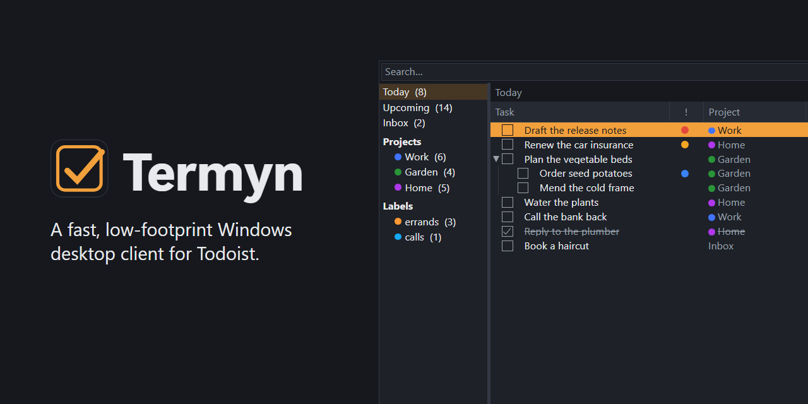

# Termyn

[](https://github.com/tridian-tn/termyn/actions/workflows/ci.yml)

WinForms on .NET 10, offline-first, keyboard-driven.

Unofficial, and not affiliated with Doist. It talks to the public [Todoist](https://todoist.com) API
with a token you supply.

## Build & test

```bash
dotnet build Termyn.slnx
dotnet test --solution Termyn.slnx
```

Requires the **.NET 10 SDK**. The build is framework-dependent and `win-x64`, so running it needs
the .NET 10 Desktop Runtime — nothing bundles the runtime, which keeps the download small and lets
it be patched on its own schedule.

To produce an installer or a portable zip, see [docs/packaging.md](docs/packaging.md).

### On a Mac

> **Mac support is under development.** The native Mac app is read-only for now: it connects to
> Todoist, shows the sidebar and the tasks in each view, and keeps them in sync. Nothing can be
> changed from it yet. `Termyn.slnx` doesn't build on a Mac, since the Windows projects target
> `net10.0-windows`; `Termyn.Mac.slnx` is the Mac's solution.

1. Install the [.NET 10 SDK](https://dotnet.microsoft.com/download/dotnet/10.0) for your Mac's
   architecture (Arm64 for Apple Silicon). It goes in `/usr/local/share/dotnet`, and `dotnet` is on
   the `PATH` in terminals opened after the install, not in ones already open.
2. Build and test the portable projects through the solution filter that leaves the Windows ones
   out:

   ```bash
   dotnet test --solution Termyn.Portable.slnf
   ```

The Mac app also needs:

3. **Xcode**, the full app from the App Store rather than the Command Line Tools alone. Open it
   once to let it finish installing, then point the command-line tools at it:

   ```bash
   sudo xcode-select -s /Applications/Xcode.app/Contents/Developer
   ```

   A macOS workload names the one Xcode it was built against and refuses any other. The Mac
   projects turn that check off (`ValidateXcodeVersion`), so a newer Xcode works too.

4. **The macOS workload.** `sudo` doesn't search the `PATH` your shell has, so `dotnet` is named in
   full:

   ```bash
   sudo /usr/local/share/dotnet/dotnet workload install macos
   ```

5. Build the app and open it:

   ```bash
   dotnet build src/Termyn.App.Mac
   ```

   ```bash
   open src/Termyn.App.Mac/bin/Debug/net10.0-macos/osx-arm64/Termyn.app
   ```

   The token is kept in your login Keychain, as an item named "Termyn – Todoist API token". A
   rebuilt app counts as a new one to the Keychain, which asks once whether it may read the token,
   quoting that name; Always Allow settles it.

CI builds and tests the portable projects on macOS and Linux as well as Windows, and builds the Mac
app. A release tag packages it too.

## What it does

Tasks, with the outline Todoist has: projects and sub-projects, sections, labels, saved filters,
and the smart views. Sub-tasks nest to the four levels Todoist holds — shown, created, folded away
and remembered folded.

- **Capture** with Todoist's quick-add syntax, from the window, a global hotkey, or the tray.
- **Edit** a task's name, due date, priority, labels and reminders; complete, reopen, reorder,
  indent, delete, and undo.
- **Descriptions** in markdown, written as the account stores them and drawn as they read.
- **Comments**, with file attachments.
- **Find** by searching, by a saved filter, or through the command palette.
- **Offline first.** Every change is applied locally and queued; the sync loop reconciles in the
  background and says what it couldn't land.

Saved filters are evaluated locally against as much of Todoist's grammar as a task can answer on
its own. Anything outside that — who a task is assigned to, which workspace it is in — is refused
by name rather than answered wrongly.

## Layout

The solution is split so the native clients share everything below the UI: the Windows one, and the Mac one being built (a Linux one could do the same):

| Project | TFM | Role |
|---|---|---|
| `src/Termyn.Core` | `net10.0` | OS-agnostic domain model, sync engine, API client, platform-service interfaces |
| `src/Termyn.Presentation` | `net10.0` | UI-framework-agnostic presenters |
| `src/Termyn.Platform.Windows` | `net10.0-windows` | Windows platform services (DPAPI token store, paths) |
| `src/Termyn.App.Windows` | `net10.0-windows` | WinForms UI + composition root |
| `src/Termyn.Platform.Mac` | `net10.0-macos` | Mac platform services (Keychain token store, paths) |
| `src/Termyn.App.Mac` | `net10.0-macos` | AppKit UI + composition root (read-only, under development) |
| `tests/Termyn.TestSupport` | `net10.0` | Shared test doubles |
| `tests/Termyn.Core.Tests`, `tests/Termyn.Presentation.Tests`, `tests/Termyn.Perf.Tests` | `net10.0` | xUnit tests over the portable core |
| `tests/Termyn.Platform.Windows.Tests`, `tests/Termyn.App.Windows.Tests` | `net10.0-windows` | xUnit tests over the Windows layers |

`Core` and `Presentation` target `net10.0` (not `-windows`), so the compiler prevents any
Windows-only API leaking into the portable core.

## Documents

Written where a decision took long enough to be worth explaining twice.

| Document | What it covers |
|---|---|
| [docs/packaging.md](docs/packaging.md) | How the installer and the portable zip are built and released |
| [docs/release-checklist.md](docs/release-checklist.md) | What to run by hand against a release build before publishing it |
| [docs/performance.md](docs/performance.md) | The start-up and rendering budgets, and what was measured against them |
| [docs/description-editor.md](docs/description-editor.md) | How the markdown panel draws and edits the same text |
| [docs/comments-pane.md](docs/comments-pane.md) | How comments and their attachments are shown |
| [docs/portable-split.md](docs/portable-split.md) | What in the Windows app belongs below the UI, and what doesn't |

## Licence

[MIT](LICENSE).
